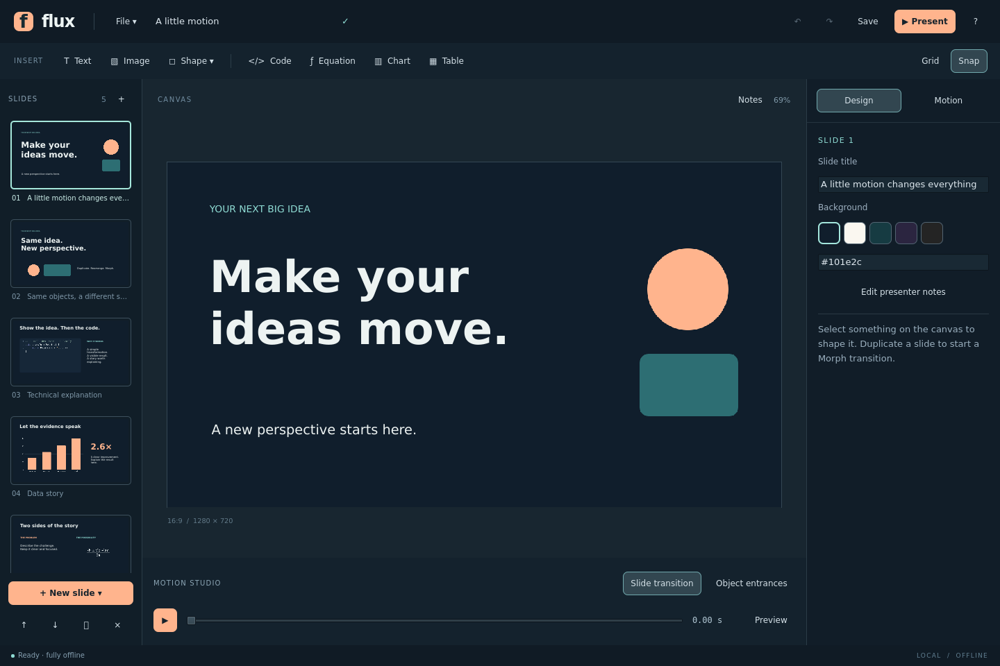

# Flux

An offline presentation editor for Linux, built with C++20 and Qt Quick/QML.
This is **version 0.1.2**, a working foundation with real editing, object-based
Morph, curved motion paths, technical content, and a presenter window.

## Build and install on Fedora

Install the development packages once (an internet connection is needed for
this step; the built application does not need one):

```bash
sudo dnf install gcc-c++ cmake ninja-build qt6-qtbase-devel qt6-qtdeclarative-devel qt6-qtwayland
```

Extract this archive, open a terminal in the `flux` directory, then run:

```bash
bash packaging/install-fedora.sh
```

The script compiles the program, runs its tests, and installs it to
`~/.local`. It does not run `sudo` or install system packages. Open **Flux**
from your applications menu or run:

```bash
~/.local/bin/flux
```

For a build without installation:

```bash
cmake -S . -B build -G Ninja -DCMAKE_BUILD_TYPE=Release
cmake --build build --parallel 2
ctest --test-dir build --output-on-failure
./build/flux
```

Requires a C++20 compiler, CMake 3.22+, and Qt 6.5+ with Core, Gui, Qml,
Quick, QuickControls2, and Test. No application dependencies are fetched by
CMake. On Wayland, install the Qt Wayland platform plugin. X11 works too.

The bundled `examples/A-little-motion.flux` is an editable copy of the example deck.

To update an existing installation, close Flux, extract this source into a
fresh directory, and run `bash packaging/install-fedora.sh` from its `flux`
directory. Your saved `.flux` presentations remain compatible. The installer
updates the executable in `~/.local`; it does not remove your project files.



## Try it in two minutes

1. The example deck opens on first launch. Select slide 2 and click **Preview**.
2. Drag the motion scrubber to inspect the transformation. Click **Back to edit**.
3. Duplicate slide 2 with **Ctrl+Shift+D**, move the circle, resize a shape,
   and preview again. The object IDs are retained, so matching is deterministic.
4. Select an object and open **Motion**. Try **Arc**, or **Bézier** with two
   control points in slide coordinates. Choose an entrance animation and
   inspect it using **Object entrances** in Motion Studio.
5. Press **Shift+F5** to present from this slide. Space advances, Left goes
   back, B blacks out the audience screen, and Escape ends the show.
6. Save with **Ctrl+S**. `.flux` files include images and work without network
   access. **File → Export PDF** exports the final static slide states.

## Implemented

| Area | Current behavior |
|---|---|
| Editing | Drag, resize, Shift-constrained resize, numeric geometry and rotation, keyboard nudge, color, opacity, text size/weight/alignment, layers, alignment, duplicate/delete |
| Context menus | Right-click objects, slide thumbnails, or empty canvas; keyboard Menu / Shift+F10 also opens the relevant menu |
| Selection | Drag a rectangle around objects; Shift/Ctrl-click, additive rectangles, Ctrl+A, selection outlines; move, nudge, duplicate, delete and align the whole selection |
| Clipboard | Cut/copy/paste native selections, including embedded images, across slides or Flux windows; paste external plain text as a text box |
| Slide management | Add, duplicate, delete, reorder; 6 layouts including a blank canvas |
| Morph | Stable IDs, position/size/rotation/color/opacity interpolation, text/content crossfades, appearing/disappearing objects |
| Paths | Straight, curved arc, cubic Bézier; smooth, linear, and ease-out timing |
| Entrances | Fade, rise, zoom, path; per-object delay and duration; timed playback after slide transitions |
| Technical content | Editable highlighted code; bounded offline TeX subset; editable bar/line charts and tab-separated tables |
| Diagrams | Rectangles, circles/ellipses, free arrows, text, layers and alignment |
| Presenting | Fullscreen audience view, forward/backward Morph and Fade, notes, next-slide preview, timer, blackout; automatic second-display selection |
| Files | Versioned JSON `.flux`, embedded PNG assets, atomic saves, debounced recovery, 80-step undo/redo |
| Export | Static vector/text PDF with embedded raster images |

## Right-click editing

| Where | Available actions |
|---|---|
| Object | Edit content/data, cut/copy/paste, duplicate/delete, arrange layers, align to slide, format, motion settings, break a previous-slide Morph match |
| Empty canvas or workspace | Paste here, insert text/shapes/code/equations/charts/tables or import an image, undo/redo, toggle grid and snap, slide settings, notes |
| Slide thumbnail | New blank slide, duplicate, rename, move earlier/later, notes, present from here, delete |

Right-clicking a selected object preserves the selection; clicking an
unselected object or slide selects that target before showing its menu.
Insertion and **Paste here** use slide coordinates at the click,
adjusted to keep the new object's bounds on the slide; imported images start
centered. Creation and placement undo together. Escape dismisses a menu.
Use **Shift+F10** or the keyboard **Menu** key with the canvas focused, or on a
thumbnail reached with Tab.

**Ctrl+X / Ctrl+C / Ctrl+V** operate on objects while the canvas has focus.
Text fields keep their normal text clipboard shortcuts. Native clipboard
copies preserve styling, content, embedded images, and motion settings.
Every paste gets a fresh object identity; duplicate a **slide** when you want
to preserve identities for Morph. Clipboard image data from other applications
is not supported yet; use **Insert → Image** instead.

The menu screenshot is in [docs/context-menu.png](docs/context-menu.png).
See [CHANGELOG.md](CHANGELOG.md) for the patch and next milestones.

## Rectangle selection

Drag from empty canvas or the surrounding workspace to draw a selection
rectangle. Objects must be fully enclosed, including their rotated bounds.
The gesture works in either direction. Hold **Shift** or **Ctrl** while
drawing to add to the current selection; Shift/Ctrl-click toggles individual
objects. **Ctrl+A** selects all objects on the current slide.

Drag any selected object to move the selection together. Arrow keys nudge it;
Shift+arrows move 10 pixels. Duplicate, delete, cut, paste, and alignment to
the slide apply to the whole selection. Each operation is one undo step.
**Escape** cancels an active rectangle and restores the previous selection;
otherwise it clears the selection. Persistent grouping, collective resizing,
and distribution are still planned. The single-object inspector remains
available when exactly one object is selected.

See [docs/rectangle-selection.png](docs/rectangle-selection.png) for the
native selection UI.

## Going backward in a presentation

**Left**, **Page Up**, and right-click now reverse the same transition used
to enter the slide being left. Morph retraces its original path, including
curves, easing, transforms, and content/background fades. A direction change
during a transition continues from its current progress. **Cut** remains
instant in both directions.

Backward navigation ends with the previous slide fully revealed; it does
not replay that slide's entrance animations. Forward navigation still runs
entrances after the transition. This fixes the earlier implementation, which
explicitly bypassed backward transitions. No enable switch is needed.

## Important boundaries in 0.1

- This is an early native application, not complete PowerPoint parity.
- PPTX import/export, video export, audio/video, collaboration, and master
  slides are not implemented. The file format and core are intentionally
  independent of a future PPTX adapter.
- Equation support is a **small TeX subset**, not a full LaTeX engine.
  Supported examples: `E = mc^2`, `a_{i}`, `\frac{a}{b}`, `\sqrt{x}`,
  Greek symbols, `\sum`, `\int`, `\cdot`, `\times`, `\pm`, `\to`, and
  comparison symbols. No external TeX installation or executable macros.
- Code highlighting is lexical and language-agnostic; it is not an IDE.
- Diagram arrows are independent objects, not connectors that stay attached
  to shapes. Persistent grouping and multi-object resizing are future work.
- Chart data uses `label,value` per line (not general CSV), up to 32 points.
  Tables use tab-separated cells and newline-separated rows, up to 40 × 16.
- Morph resizes visual content with transforms; complex chart/table/text
  changes crossfade. It does not semantically morph individual letters or
  individual chart points. Different object kinds crossfade.
- Object entrances are time-based after a slide transition; per-click build
  sequencing is future work. Selecting **Cut** skips the slide transition.
- Only 16:9 / 1280 × 720 documents are supported in this version.
- PDF contains static final states; it cannot preserve animation.
- Second-display presentation needs verification on your own Wayland/X11
  compositor and monitor arrangement. If only one display is present, the
  audience view opens fullscreen; exit with Escape. The separate presenter
  window can be opened from File while presenting.

## Local files and recovery

No sign-in, telemetry, server, browser engine, or online service is used.
Images are decoded, resized to at most 4096 × 4096, and embedded as PNG.
The document parser accepts local files up to 64 MiB, with up to 200 slides
and 250 objects per slide. Project files are readable JSON and have a format
version. Save errors leave the existing project in place.

After 1.5 seconds without an edit, an unsaved draft is written to the Qt
application data directory (normally `~/.local/share/Flux/Flux/recovery`).
A recovery banner offers the newest interrupted session on next launch.
Ordinary saves and explicitly discarded sessions remove their own draft.
Recovery drafts are not a substitute for saving your project.

## Architecture and efficiency

See [docs/architecture.md](docs/architecture.md) and
[docs/verification.md](docs/verification.md).

The runtime is C++ and Qt Quick. QML defines the interface and scene;
C++ owns document operations, persistence, geometry interpolation, technical
content rendering, and PDF output. The motion core has no Qt dependency.
Shapes and text use Qt Quick scene-graph items. Technical items paint into
Qt Quick textures when their content changes; transitions transform those
items without repainting their contents on every animation frame.

The included CI workflow builds and tests on Fedora when the source is
pushed to your own GitHub repository. No repository is created automatically.

## Useful commands

```bash
# Test only the portable C++ engine, without Qt
cmake -S . -B build-core -DFLUX_CORE_ONLY=ON
cmake --build build-core
ctest --test-dir build-core --output-on-failure

# Start the real UI without a display server for a smoke test
QT_QPA_PLATFORM=offscreen QT_QUICK_BACKEND=software ./build/flux --smoke-test

# Open an existing project
./build/flux /path/to/deck.flux
```

The source is MIT-licensed. Qt is a separate dependency with its own licenses.
